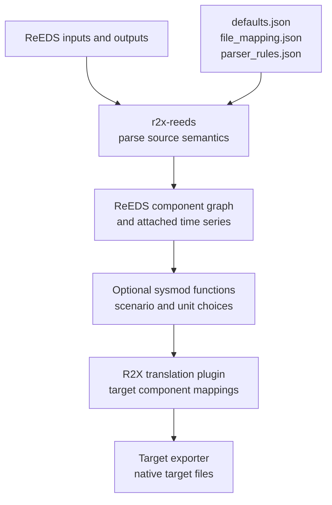
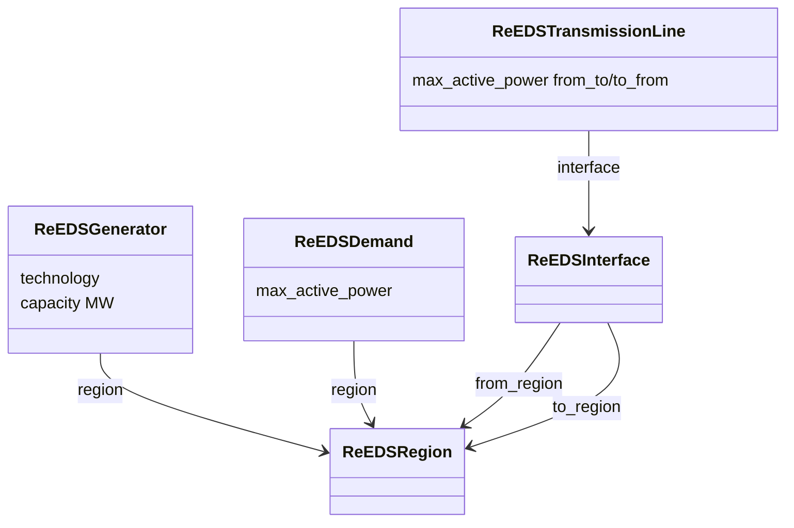

ReEDS reports describe an investment model: regional technology totals, costs and
representative profile inputs. A production-cost target needs its own component
types, operational fields and native file format. Keeping those decisions in
separate packages makes it possible to inspect where a value changed.

## Three boundaries to verify

The parser's dataset mappings define names, source paths and preprocessing;
its rules map normalized rows into ReEDS component fields. The defaults file
supplies exclusions, categories and model constants. Read [configuration](/r2x-reeds/reference/configuration/)
before overriding one of these assets: a filename change and a modeling change
belong to different boundaries.

[ReEDS-to-PLEXOS](https://github.com/NatLabRockies/R2X/tree/main/packages/r2x-reeds-to-plexos)
and [ReEDS-to-Sienna](https://github.com/NatLabRockies/R2X/tree/main/packages/r2x-reeds-to-sienna)
map the parsed graph into their target models. [r2x-plexos](https://github.com/NatLabRockies/r2x-plexos)
and [r2x-sienna](https://github.com/NatLabRockies/r2x-sienna) provide target models
and exporters. Installing only the parser does not provide either complete export.

## References are graph edges, profiles are attached data

Generators and demand reference region components; transmission lines reference
an interface whose endpoints are regions. These are object relationships, not
independent copies of region names. [Infrasys](https://github.com/NatLabRockies/infrasys)
manages the graph and attached time-series storage. A capacity field and an hourly
series on the same component answer different questions; inspect both.

## Solve year versus weather year

`solve_year` selects an investment/capacity snapshot. `weather_year` selects the
weather-driven profile inputs. The Pacific fixture uses a 2032 fleet with 2012
profiles; its demand series therefore starts in 2012. Do not infer a solve year
from the series timestamp alone. The config accepts lists, but downstream
transforms/exporters may accept only scalar selections; start with one of each
as in the [tutorial](/r2x-reeds/tutorials/parse-run/).

## Why modifiers are explicit

A large ReEDS generator block may need disaggregation for a target workflow.
`break_generators` changes unit counts using reference sizes and may drop small
remainders according to the selected threshold. Purchaser load, Canadian imports,
CCS credits and emission caps make other scenario-specific choices. Applying
all transforms indiscriminately can duplicate or alter assumptions.

Modifier functions mutate the system and return `Result[System, str]`. Check
errors and save a baseline before a transformation when you need comparison.
There is no universal modifier order: optimal siting needs existing demand
profiles, while an emissions calculation must see the fleet you intend to constrain.
See [transform reference](/r2x-reeds/reference/transforms/) for each contract.

## Serialization is a checkpoint, not an export

`system.to_json(...)` preserves the Python component graph and time-series
references for reloading. It is useful for comparing parser and modifier outputs,
but it is not a native PLEXOS or Sienna model. Keep the JSON and its generated
time-series directory together and keep the model classes importable.
[Saved-system inspection](/r2x-reeds/how-to/inspect-system/) demonstrates both
Python and CLI loading. The [R2X architecture](https://natlabrockies.github.io/R2X/explanation/architecture/)
explains the later translation/export boundaries.
