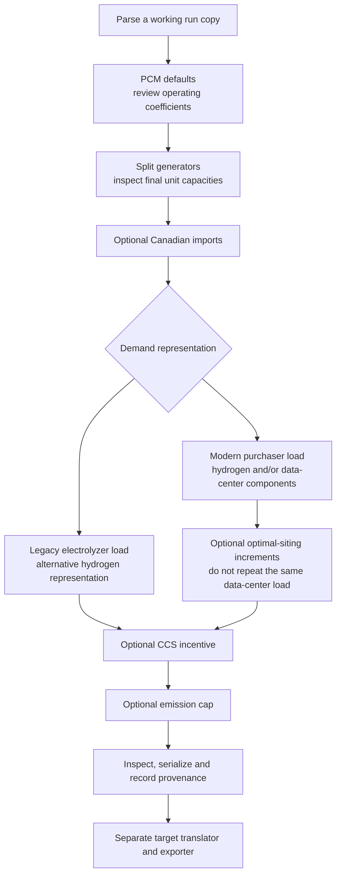

Choose and verify the source-system modifications needed before handing ReEDS
results to a production-cost-model translator. This guide covers **all eight**
registered `r2x.transforms` in current main and the published `r2x-reeds` 0.9.3
package. It does not treat eight successful plugin calls as proof of a valid PCM.

The [ReEDS model](https://github.com/ReEDS-Model/ReEDS) produces the capacity-expansion runs consumed here. `r2x-reeds` parses those results and applies optional system modifiers; it does not solve the ReEDS model.

Start with the [pip-based Pacific tutorial](/r2x-reeds/tutorials/parse-run/) or your
own completed ReEDS run. Keep original inputs and a parser-only checkpoint for
comparison. Install [r2x-cli](https://github.com/NatLabRockies/r2x-cli#install), then
install the published parser into its managed environment:

```bash
r2x install r2x-reeds
```

Discover the actual installed inventory before copying a pipeline:

```bash
r2x list r2x-reeds
```

For a plugin's current config help, use its entry-point name, for example:

```bash
r2x run add-pcm-defaults --help
```

Python virtual environments and the CLI runtime are separate. Record the package
versions, solve/weather years, selected pipeline and input/policy file revisions
with the saved output. The examples below use one solve year and one weather year.

## Complete modifier inventory

| Entry point             | Public config / Python module                  | Main effect                                                 |
| ----------------------- | ---------------------------------------------- | ----------------------------------------------------------- |
| `add-pcm-defaults`      | `PCMDefaultsConfig`, `sysmod.pcm_defaults`     | Fill or override generator operating fields                 |
| `break-gens`            | `BreakGensConfig`, `sysmod.break_gens`         | Split aggregated generator blocks                           |
| `add-imports`           | `ImportsConfig`, `sysmod.imports`              | Attach Canadian import energy budgets                       |
| `add-purchaser-load`    | `PurchaserLoadConfig`, `sysmod.purchaser_load` | Explicit hydrogen-production and data-center demand         |
| `add-electrolyzer-load` | `ElectrolyzerConfig`, `sysmod.electrolyzer`    | Legacy fixed electrolyzer load and hydrogen prices          |
| `add-optimal-siting`    | `OptimalSitingConfig`, `sysmod.optimal_siting` | Add loadsite increments to existing electric demand         |
| `add-ccs-credit`        | `CCSCreditConfig`, `sysmod.ccs_credit`         | Apply capture incentives to eligible generators             |
| `add-emission-cap`      | `EmissionCapConfig`, `sysmod.emission_cap`     | Record an annual CO2 limit and optional precombustion rates |

The Python module prefix is `r2x_reeds.`. See [registered entry points](https://github.com/NatLabRockies/r2x-reeds/blob/86db7099fd409cff64f96e51b09a32a010b13cf5/pyproject.toml)
and [public fields/source links](/r2x-reeds/reference/transforms/#configuration-fields-and-source).
All eight config models allow omitted file paths, but several plugins then return
success without changing anything. **Operational input requirements below are
stricter than model-construction requirements.** Check effects, not just exit status.

## Choose a sequence and avoid double counting



This is a defensible preparation order, not a universal requirement. Apply
capacity-dependent defaults before splitting when following this recipe. Apply
incentives and constraints after the fleet representation is settled. Existing
electric demand profiles must be present before optimal siting.

Choose **one representation for the same hydrogen load**: the modern purchaser
modifier or the legacy electrolyzer modifier. Likewise, do not feed the same
`loadsite_op` increments to both purchaser-load data-center creation and optimal
siting unless you have explicitly separated which demand each represents.
Neither pair is a general deduplication mechanism.

## 1. Add operating defaults without rescaling startup coefficients

`add-pcm-defaults` accepts `pcm_defaults_dict` or `pcm_defaults_fpath`; the inline
dictionary takes precedence. Lookup tries generator name, then technology, then
category. `pcm_defaults_override=False` fills only missing/null fields; `True`
intentionally replaces existing values. Unknown model fields are not applied,
and an unmatched generator can be skipped.

For the runnable base profile below, create `policy/pcm-defaults.json`:

```bash
mkdir -p policy
```

```json
{
  "gas-cc": { "startup_cost": 50.0 }
}
```

The coefficient **50 dollars/MW is an illustrative policy input**, not a recommended
calibration. The base example explicitly overrides only this field to make its
effect inspectable. For production use reviewed defaults and normally start with
override disabled.

`startup_cost` remains **$/MW** through defaults and generator splitting. Do not
multiply it by the original aggregated capacity. A downstream exporter converts
the coefficient using the final unit capacity; applying that conversion twice
would inflate startup costs. For example, a final 100 MW unit with a 50 $/MW
coefficient corresponds to a 5,000-dollar startup charge, converted once by the
appropriate target layer. Current splitting preserves the coefficient on each new unit. `ramp_rate` defaults are treated differently by this implementation:
PCM defaults multiplies them by capacity. Inspect its output and target-unit
contract rather than assuming every numeric default follows startup-cost behavior.

**Check:** select matched thermal units and compare `startup_cost` before/after;
then check the coefficient remains 50 after splitting. Review unmatched/missing
fields explicitly. Re-running override-enabled defaults is not a universal
idempotence guarantee for capacity-scaled fields.

## 2. Disaggregate generator blocks

`break-gens` uses packaged reference sizes when `reference_units=None`; override
with a JSON path or mapping. `break_category="category"` chooses the matching
field. `drop_capacity_threshold=5` discards remainders at or below 5 MW. Set an
explicit threshold and reconcile any removed MW rather than expecting exact
capacity conservation with that option enabled.

`skip_categories`, `include_regions`, `include_generators` and
`include_technologies` restrict eligible units. Multiple include filters use OR,
not AND. This modifier mutates the system and copies relationships, time-series
associations and operating fields to split units.

**Check:** record generator counts and total MW before/after, inspect selected
unit capacities and startup coefficients, and account for discarded remainders.
The Pacific baseline with the package's reference sizes has 292 generators before
splitting and 673 afterward; counts are not a validation rule for other cases.

## 3. Add Canadian import energy budgets when applicable

`add-imports` needs `weather_year`, `canada_imports_fpath`,
`canada_szn_frac_fpath` and `hour_map_fpath`. Wide import files also need
`solve_year` and a column named for that year. Inputs must supply regional annual
imports, seasonal fractions and a chronological season mapping. The reader
supports known source aliases such as `*szn`/`frac_weighted` and
`*timestamp`/`actual_period`; compare your schema with the source before use.

It attaches **daily `hydro_budget` in GWh**, not hourly import power in MW.
Daily fractions are normalized, and the annual input is divided by 1000 when
constructing those GWh budgets. Check that the annual input is in the corresponding
MWh basis. `solve_year` is retained as a time-series selection feature when supplied.

The parser excludes `can-imports` by default. Before choosing an imports profile,
retain the other current exclusions but allow imports:

```yaml
excluded_techs: [electrolyzer, smr, smr_ccs]
```

This replaces the exclusion list; it is not an append operation. The modifier
cannot attach budgets to import generators that were never parsed.

**Check:** inspect matched import generators, list their `hydro_budget` series,
confirm daily resolution and reconcile summed GWh with annual MWh divided by 1000. Supply matching series-selection features when querying them. Verify the
season map covers the intended year; a successful no-op is not an import schedule.

`add-exports` adds hourly Canadian exports in MW to each matching region's
existing `ReEDSDemand.max_active_power` profile. It expands the
representative-hour fractions through the hour map, normalizes them for the
selected weather year, then scales them by the region's annual exports for the
selected solve year. The added hourly energy therefore reconciles to the annual
MWh input. A regional demand component with an existing hourly profile is
required; Canadian export generators are not used by this modifier. The
`can-exports` parser exclusion does not affect this demand-side addition.

```yaml
excluded_techs:
  # - can-imports
  # - can-exports
  - electrolyzer
  - smr
  - smr_ccs
```

## 4. Choose modern purchaser demand

`add-purchaser-load` requires `hour_map_myr_fpath` to do useful work.
`weather_year` defaults to 2012; select `solve_year` when inputs contain several
years. Supply only the applicable optional data:

- `hydrogen_production_capacity_fpath`: `cap` data for electrolyzer, SMR or SMR-CCS components.
- `consume_characteristics_fpath`: electricity-efficiency characteristics used by those consumers.
- `hydrogen_production_load_fpath`: representative-period production load.
- `hydrogen_production_annual_load_fpath`: optional annual targets used to scale production profiles.
- `loadsite_op_fpath`: data-center demand by representative period.

The reader supports these CSV inputs and named groups in ReEDS output HDF5 files;
see [the dedicated purchaser-load guide](/r2x-reeds/how-to/purchaser-load/).
It creates `ReEDSElectrolyzerDemand`, `ReEDSSteamMethaneReformingDemand` and/or
`ReEDSDataCenterDemand` and attaches `max_active_power` profiles. Existing demand
components can suppress capacity-based duplicate creation; that does not make
all repeated profile application safe.

**Check:** compare component names, counts, hourly MW and annual profile sums with
the selected source technology, region and year. Verify scaling against annual
targets where supplied. The `pcm-hydrogen` profile below omits `loadsite_op_fpath`
so a separate siting profile cannot add the same data-center demand twice.

## 5. Or choose the legacy electrolyzer representation

`add-electrolyzer-load` is the alternative for legacy fixed-load inputs.
It needs `weather_year` and `hour_map_fpath`; provide
`electrolyzer_load_fpath` and/or `h2_fuel_price_fpath` for the effects you want.
Normalized load columns are `region,hour,load_MW`; hydrogen prices use
`region,month,h2_price`. The hour map must join on `hour`. Do not point this at an
arbitrary raw `prod_load.csv` and assume purchaser-load normalization applies.

It creates `ReEDSDemand` named `<region>_electrolyzer` with a `fixed_load` series;
loads below 1 MW are skipped. Hydrogen price input affects matching hydrogen-fuel
generators. The Python function is historically spelled `add_electrolizer_load`;
the CLI name remains `add-electrolyzer-load`.

**Check:** inspect the new fixed-load profiles, weather-year timestamps and
hydrogen-fuel prices. Use `pcm-legacy` instead of the modern purchaser profile for
the same demand, not in addition to it.

## 6. Add cost-optimal siting increments to existing electric load

`add-optimal-siting` needs `loadsite_op_fpath` and `hour_map_myr_fpath`.
Select `solve_year` when filtering a multi-year file; the config also accepts a
list and selects its first year. Source aliases such as `r,allh,t,Value` are
normalized before representative periods expand into sequential hours.

The modifier adds increments to existing `ReEDSDemand` profiles. It does not
create a demand profile when none exists. In `pcm-sited`, purchaser demand
contains hydrogen only; the site increments therefore are not also represented
by purchaser-created data-center components.

**Check:** snapshot the original electric-load series and compare the hourly
difference and annual sum with the chosen loadsite increments. Confirm that
unselected regions/years did not change and that profiles retain compatible
length, timestamp and resolution.

## 7. Apply CCS credit economics to eligible units

`add-ccs-credit` needs all three paths:
`co2_incentive_fpath`, `emission_capture_rate_fpath` and `upgrade_link_fpath`.
Use normalized columns `tech,region,vintage,incentive`,
`tech,region,vintage,capture_rate`, and `from,to,region,vintage`, respectively.
Resolve any multi-year selection before supplying these inputs. Unknown or
unmatched technologies can remain unchanged.

The modifier writes `generator.ext["UoS Charge"]` as **negative $/MWh**, computed
from incentive $/ton times capture rate ton/MWh. This is a credit, not a startup
cost or a one-time dollars-per-unit value. Keep the ton convention consistent.

**Check:** inspect the affected units' `UoS Charge` and manually recompute at least
one row. Confirm that your downstream translator/exporter carries this metadata
into the intended target property; preserving an `ext` value alone does not prove
that the PCM consumes it.

## 8. Record annual emission policy

`add-emission-cap` needs existing CO2 supplemental attributes and either an
explicit `emission_cap` or a compatible `co2_cap_fpath`. The file reader expects a
single `value` cell. A raw multi-year ReEDS `co2_cap.csv` with
`*t,tonne_per_year` is not that normalized shape; select the intended year and
supply its value explicitly or prepare a one-row input.

`default_unit="tonne"` is the default. `switches_fpath` and
`emission_rates_fpath` optionally enable precombustion additions; those inputs
must match the helper's expected switch and generator/emission/rate schemas.
Do not blindly pass an unnormalized raw emissions report.

The stored constraint uses a metric scalar of 1000. Changing a unit label is not
a general unit conversion. Inspect the constraint metadata and confirm its
translation to the target emission policy before a PCM solve. Some system
versions store this metadata in `ext`, others through a legacy fallback; do not
assume all target exporters automatically consume it.

**Check:** verify a CO2 attribute exists, inspect the selected cap/year/units and
manually reconcile the target cap and emission-rate basis. An absent cap or CO2
attribute can produce a successful no-op. The fixture's raw cap file is not used
as a normalized one-row policy file in the example below.

## A coherent CLI pipeline with explicit optional profiles

Save the following as `pcm-preparation.yaml` in the tutorial workspace.
`pcm-base` is the executed fixture-supported profile. The other profiles are
**templates requiring the external policy/input files described above**; paths
under `policy/` are normalized inputs you must prepare, not files shipped by pip
or guaranteed by the Pacific fixture. Replace run/year selections for a real case.

```yaml
variables:
  run_dir: tutorial-inputs/test_Pacific
  solve_year: 2032
  weather_year: 2012
pipelines:
  pcm-base:
    - reeds-parser
    - add-pcm-defaults
    - break-gens
  pcm-hydrogen:
    - reeds-parser
    - add-pcm-defaults
    - break-gens
    - add-imports
    - add-purchaser-load
    - add-ccs-credit
    - add-emission-cap
  pcm-sited:
    - reeds-parser
    - add-pcm-defaults
    - break-gens
    - add-imports
    - add-purchaser-load
    - add-optimal-siting
    - add-ccs-credit
    - add-emission-cap
  pcm-legacy:
    - reeds-parser
    - add-pcm-defaults
    - break-gens
    - add-imports
    - add-electrolyzer-load
    - add-ccs-credit
    - add-emission-cap
config:
  reeds-parser:
    path: ${run_dir}
    solve_year: ${solve_year}
    weather_year: ${weather_year}
    case_name: pcm-handoff
  add-pcm-defaults:
    pcm_defaults_fpath: policy/pcm-defaults.json
    pcm_defaults_override: true
  break-gens:
    drop_capacity_threshold: 5
  add-imports:
    solve_year: ${solve_year}
    weather_year: ${weather_year}
    canada_imports_fpath: policy/imports.csv
    canada_szn_frac_fpath: policy/import-season-fractions.csv
    hour_map_fpath: policy/import-hour-map.csv
  add-purchaser-load:
    solve_year: ${solve_year}
    weather_year: ${weather_year}
    hour_map_myr_fpath: policy/hmap_myr.csv
    hydrogen_production_capacity_fpath: policy/hydrogen-capacity.csv
    consume_characteristics_fpath: policy/consume-characteristics.csv
    hydrogen_production_load_fpath: policy/hydrogen-load.csv
    hydrogen_production_annual_load_fpath: policy/hydrogen-annual-load.csv
  add-electrolyzer-load:
    weather_year: ${weather_year}
    hour_map_fpath: policy/legacy-hour-map.csv
    electrolyzer_load_fpath: policy/legacy-electrolyzer-load.csv
    h2_fuel_price_fpath: policy/legacy-hydrogen-prices.csv
  add-optimal-siting:
    solve_year: ${solve_year}
    loadsite_op_fpath: policy/loadsite_op.csv
    hour_map_myr_fpath: policy/hmap_myr.csv
  add-ccs-credit:
    co2_incentive_fpath: policy/ccs-incentives.csv
    emission_capture_rate_fpath: policy/capture-rates.csv
    upgrade_link_fpath: policy/upgrade-links.csv
  add-emission-cap:
    co2_cap_fpath: policy/co2-cap-selected-year.csv
    default_unit: tonne
```

Before an imports profile, add the explicit exclusion-list override described in
step 3 to `config.reeds-parser`. Before a data-center purchaser branch, add its
`loadsite_op_fpath` but remove optimal siting for those same increments. The YAML
never runs modern and legacy hydrogen representations together.

List the profiles, then preview only the baseline you have inputs for:

```bash
r2x run pcm-preparation.yaml --list
```

```bash
r2x run pcm-preparation.yaml pcm-base --dry-run
```

Expect `reeds-parser → add-pcm-defaults → break-gens`. Dry run checks pipeline
resolution; it does not prove any external policy file has the correct schema.
Create the output folder and execute that base profile:

```bash
mkdir -p outputs
```

```bash
r2x run pcm-preparation.yaml pcm-base --zip -o outputs/pcm-prepared.zip
```

Select `pcm-hydrogen`, `pcm-sited` or `pcm-legacy` only after preparing their
external files and validating each modifier's effect on a checkpoint copy.

## Inspect before handing off

After running `pcm-base`, open Python in the tutorial workspace to create a
repeatable inspection script. It checks the documented 50 $/MW example policy.
The CLI supplies its loaded system as `sys`:

```python doctest
>>> from pathlib import Path
>>> inspection = """from r2x_reeds import ReEDSGenerator, ReEDSThermalGenerator, ReEDSDemand
... assert len(list(sys.get_components(ReEDSGenerator))) == 673
... matched = [g for g in sys.get_components(ReEDSThermalGenerator) if g.technology == "gas-cc"]
... assert matched
... assert all(g.startup_cost == 50.0 for g in matched)
... for load in sys.get_components(ReEDSDemand):
...     for profile in sys.list_time_series(load):
...         assert len(profile.data) == 8760
... print("Verified 673 generators, 50 $/MW startup coefficients and hourly profiles")
... """
>>> _ = Path("inspect_pcm.py").write_text(inspection)
```

Leave Python with `exit()`, then run the script through the CLI from the tutorial
workspace in your shell:

```bash
r2x read outputs/pcm-prepared.zip --zip --exec inspect_pcm.py
```

For the baseline fixture, expect `Verified 673 generators, 50 $/MW startup coefficients and hourly profiles`. Record total MW and inspect load lengths/timestamps. The coefficient is
still $/MW on the final units. Your own policy inputs should replace these
fixture-specific assertions. Use [saved-system inspection](/r2x-reeds/how-to/inspect-system/)
for direct Infrasys loading and profile values.

The prepared artifact still contains **ReEDS components**. Handoff to
[r2x-reeds-to-plexos](https://github.com/NatLabRockies/R2X/tree/main/packages/r2x-reeds-to-plexos)
plus [r2x-plexos](https://github.com/NatLabRockies/r2x-plexos), or the
[Sienna translation workflow](https://natlabrockies.github.io/R2X/how-to/reeds-to-sienna/)
with [r2x-sienna](https://github.com/NatLabRockies/r2x-sienna), as appropriate.
Verify target properties, costs, emissions and profile units at that boundary.
A serialized source system is a review checkpoint, not a native PCM export.
Verify policy metadata after reload as well: do not assume a legacy dynamic
constraint attribute survives every serializer; retain the selected policy input
and pass it explicitly to the target workflow when required.

## Tested coverage and limits

The published-package Pacific parse/modifier/reload tutorial, `pcm-base`, its
startup-coefficient inspection, and CLI artifact loading were executed. The
repository's focused tests exercise all eight modifiers with purpose-built data,
including startup-cost preservation. They are distinct from an all-modifier
production run. Imports, purchaser/legacy demand, optimal siting, CCS and emission
policy profiles above were **not** run against a complete external production
case; their schemas, optional behavior and units were checked against current
public configs and source. Supply and validate the needed inputs before claiming
a PCM-ready handoff. For failures, use [troubleshooting](/r2x-reeds/troubleshooting/).
