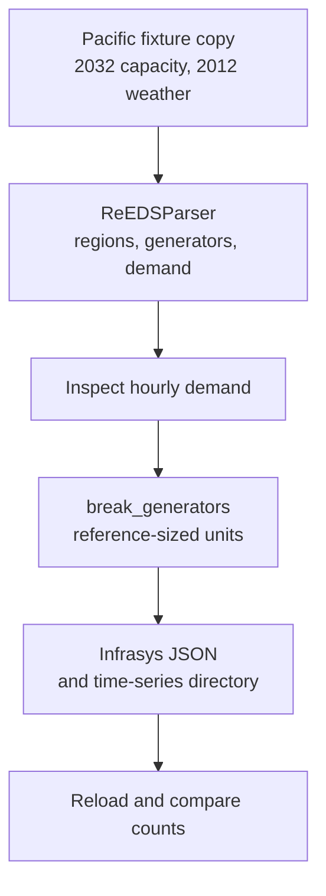

Turn the repository's Pacific test run into a saved, inspectable system. You will
read ReEDS data, inspect an hourly demand profile, split aggregated generators
into reference-sized units, and reload the result with Infrasys-compatible APIs.
No licensed target-model software or external ReEDS run is needed for this fixture.

The [ReEDS model](https://github.com/ReEDS-Model/ReEDS) produces the capacity-expansion runs consumed here. `r2x-reeds` parses those results and applies optional system modifiers; it does not solve the ReEDS model.

## What you will build



The saved artifact contains ReEDS components, not a PLEXOS or Sienna export.
Target conversion is a later step performed by [R2X translation plugins](https://github.com/NatLabRockies/R2X).

## Before you start

Complete [installation](/r2x-reeds/getting-started/installation/),
[environment setup](/r2x-reeds/getting-started/environment/) and
[verification](/r2x-reeds/getting-started/verify/). Keep that environment active and
work in your empty `reeds-example` directory. This tutorial uses the public `r2x-reeds` 0.9.3 and `r2x-core` 0.9 APIs. No source checkout is required.

## Download sample data separately

The test fixture is repository data, not an installed package resource. Download
the archive from the verified revision below; the pinned URL keeps the expected
counts tied to the same data even when main changes. This is a **data download**,
not a source installation. `curl` is needed for this step.

```bash
mkdir -p inputs
```

```bash
curl -fL \
  https://raw.githubusercontent.com/NatLabRockies/r2x-reeds/86db7099fd409cff64f96e51b09a32a010b13cf5/tests/data/test_Pacific.zip \
  -o inputs/test_Pacific.zip
```

The archive is about 30 MB and extracts to roughly 62 MB. The parser can upgrade
run files, so preserve the downloaded archive and work on the extracted copy:

```bash
python -m zipfile -e inputs/test_Pacific.zip tutorial-inputs
```

Check the run root:

```bash
ls tutorial-inputs/test_Pacific
```

Expect `meta.csv`, `inputs_case/` and `outputs/`. Run the remaining commands from
`reeds-example/` with the environment active. The data-store path must point to
this run root, not just `outputs/`.

Current parser builds also read operating-cost inputs omitted from the reduced
Pacific archive. From `reeds-example/`, download these seven small CSVs from the
same verified source used by the parser tests. This updates only the extracted
working copy:

```bash
(for dataset in plantcharout hyd_fom scalars switches hintage_data upgrade_link tech-subset-table; do
  curl -fL "https://raw.githubusercontent.com/NatLabRockies/r2x-reeds/86db7099fd409cff64f96e51b09a32a010b13cf5/tests/data/test_Upgrader/inputs_case/${dataset}.csv" -o "tutorial-inputs/test_Pacific/inputs_case/${dataset}.csv" || exit 1
done)
```

Expect seven successful downloads. These files supply FOM and technology inputs.
Keep them with the extracted run before parsing.

The archive holds its technology-upgrade set in `inputs.h5`. Some published
parser mappings also require a CSV form. In the Python session below, derive
that CSV from the same HDF5 values in the working copy. This keeps the two input
representations consistent:

```python doctest
>>> import csv
>>> import h5py
>>> from pathlib import Path
>>> run_path = Path("tutorial-inputs/test_Pacific")
>>> with h5py.File(run_path / "inputs_case/inputs.h5") as bundle:
...     technologies = bundle["unitspec_upgrades"]["i"].asstr()[:].tolist()
...
>>> assert len(technologies) == 7
>>> with (run_path / "inputs_case/unitspec_upgrades.csv").open("w", newline="") as output:
...     writer = csv.writer(output)
...     _ = writer.writerow(["*i"])
...     writer.writerows([[name] for name in technologies])
...
```

The generated CSV has the same seven technology names as the archive. Keep both
forms beside the other input tables. Continue in this Python session when parsing.

## Parse the selected solve and weather years

Continue in the same Python session used to prepare the technology CSV. Enter
the following statements, then keep this session for the later Python sections:

```python doctest
>>> from pathlib import Path
>>> from r2x_core import DataStore, PluginContext
>>> from r2x_reeds import ReEDSConfig, ReEDSParser, ReEDSRegion, ReEDSGenerator
>>> run_path = Path("tutorial-inputs/test_Pacific")
>>> config = ReEDSConfig(
...     solve_year=2032,
...     weather_year=2012,
...     case_name="Pacific-2032",
... )
>>> store = DataStore.from_plugin_config(config, path=run_path)
>>> context = PluginContext(config=config, store=store)
>>> system = ReEDSParser.from_context(context).run().system
>>> if system is None:
...     raise RuntimeError("Parser returned no system")
...
>>> assert len(list(system.get_components(ReEDSRegion))) == 11
>>> assert len(list(system.get_components(ReEDSGenerator))) == 292
```

`solve_year` selects the investment/capacity snapshot; `weather_year` selects
profile data. These are different choices. The context ties configuration and
its mapped input datasets together; `run()` executes the lifecycle and returns
that context. See [the API contract](/r2x-reeds/reference/python-api/).

The console checks below verify the expected fixture counts.

These counts describe the checked-in fixture, not an arbitrary ReEDS case.
For a real run, choose years present in that run and compare its region names
and capacities before translation. [Troubleshooting](/r2x-reeds/troubleshooting/)
explains missing-data and year errors.

## Inspect a demand profile

Continue in the same Python session:

```python doctest
>>> from r2x_reeds import ReEDSDemand
>>> load = next(system.get_components(ReEDSDemand))
>>> profile = system.list_time_series(load)[0]
>>> from datetime import datetime, timedelta
>>> from numpy.testing import assert_allclose
>>> assert load.name == "p1_load"
>>> assert profile.name == "max_active_power"
>>> assert profile.initial_timestamp == datetime(2012, 1, 1)
>>> assert profile.resolution == timedelta(hours=1)
>>> assert_allclose(profile.data[:3], [7662.1055, 7358.9473, 7142.1055], rtol=1e-6)
>>> assert len(profile.data) == 8760
```

Expect demand `p1_load`, series `max_active_power`,
8,760 values, a start of `2012-01-01 00:00:00`, and one-hour resolution.
The first three values are approximately `7662.1055`, `7358.9473`, `7142.1055`.
A correct component count alone would not catch a wrong weather year or profile
resolution; inspect both the graph and the attached time series.

## Apply an explicit modifier

ReEDS investment blocks are aggregated units. `break_generators` can split them
using the package's reference sizes. Continue in the same Python session:

```python doctest
>>> from r2x_reeds.sysmod.break_gens import BreakGensConfig, break_generators
>>> result = break_generators(system, BreakGensConfig(drop_capacity_threshold=5))
>>> if result.is_err():
...     raise RuntimeError(result.unwrap_err())
...
>>> system = result.unwrap()
>>> assert len(list(system.get_components(ReEDSGenerator))) == 673
```

The fixture now has 673 generators, while its regions stay
at 11. `drop_capacity_threshold` controls small remainders in MW; splitting is a
modeling choice, not a requirement for every target. The function mutates the
system and returns a `Result`; check failure before continuing. For targeted
splitting and reference-unit overrides, see [Python composition](/r2x-reeds/how-to/reeds-to-x-script/)
and [transform configuration](/r2x-reeds/reference/transforms/).

## Save and reload the modified system

Continue in the same Python session:

```python doctest
>>> from r2x_core import System
>>> output = Path("outputs/pacific-system.json")
>>> output.parent.mkdir(parents=True, exist_ok=True)
>>> system.to_json(output, overwrite=True)
>>> restored = System.from_json(output)
>>> assert len(list(restored.get_components(ReEDSRegion))) == 11
>>> assert len(list(restored.get_components(ReEDSGenerator))) == 673
```

`overwrite=True` deliberately replaces this tutorial output when you rerun the
script. Use a fresh path or leave overwrite disabled for production snapshots.
The assertions verify 11 reloaded regions and 673 reloaded generators.

Leave Python with `exit()`, then inspect the output directory from the tutorial
workspace in your shell:

```bash
ls outputs
```

Keep `pacific-system.json` and its sibling `pacific-system_time_series/` directory
together. The JSON stores component relationships; the directory holds the attached
series. Moving only the JSON is not a complete transfer.

## Inspect from the CLI or continue to a target

The [saved-system guide](/r2x-reeds/how-to/inspect-system/) shows `r2x read` and
repeatable inspection scripts. It uses the CLI's own environment; the source
checkout's `uv` environment is separate.

For a native target export, continue with [ReEDS to PLEXOS](https://natlabrockies.github.io/R2X/how-to/reeds-to-plexos/)
or [ReEDS to Sienna](https://natlabrockies.github.io/R2X/how-to/reeds-to-sienna/).
Those workflows add a translator and target exporter after the parser; the
serialized ReEDS JSON above is not either target's native format.

The documentation tests execute these console assertions against the current
source and its locked dependencies. The count/profile/reload checks apply to
this fixture revision and selected years. Published package versions can differ
from current source, especially in optional input upgrades and operating-cost fields.
