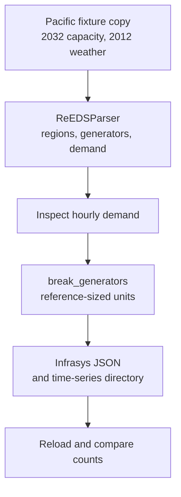

Turn the repository's Pacific test run into a saved, inspectable system. You will
read ReEDS data, inspect an hourly demand profile, split aggregated generators
into reference-sized units, and reload the result with Infrasys-compatible APIs.
No licensed target-model software or external ReEDS run is needed for this fixture.

The [ReEDS model](https://github.com/ReEDS-Model/ReEDS) produces the capacity-expansion runs consumed here. `r2x-reeds` parses those results and applies optional system modifiers; it does not solve the ReEDS model.

## What you will build



The saved artifact contains ReEDS components, not a PLEXOS or Sienna export.
Target conversion is a later step performed by [R2X translation plugins](https://github.com/NatLabRockies/R2X).

## Before you start

Complete [installation](/r2x-reeds/getting-started/installation/),
[environment setup](/r2x-reeds/getting-started/environment/) and
[verification](/r2x-reeds/getting-started/verify/). Keep that environment active and
work in your empty `reeds-example` directory. The examples use the public parser lifecycle and the `r2x-core` dependency
specified by this checkout.

## Download sample data separately

The test fixture is repository data, not an installed package resource. Download
the archive from the verified revision below; the pinned URL keeps the expected
counts tied to the same data even when main changes. This is a **data download**,
not a source installation. `curl` is needed for this step.

```bash
mkdir -p inputs
```

```bash
curl -fL \
  https://raw.githubusercontent.com/NatLabRockies/r2x-reeds/ebb69534188c7b94933c36a534d84a651114e2f9/tests/data/test_Pacific.zip \
  -o inputs/test_Pacific.zip
```

The archive is about 30 MB and extracts to roughly 62 MB. The parser can upgrade
run files, so preserve the downloaded archive and work on the extracted copy:

```bash
python -m zipfile -e inputs/test_Pacific.zip tutorial-inputs
```

Check the run root:

```bash
ls tutorial-inputs/test_Pacific
```

Expect `meta.csv`, `inputs_case/` and `outputs/`. Run the remaining commands from
`reeds-example/` with the environment active. The data-store path must point to
this run root, not just `outputs/`.

## Parse the selected solve and weather years

Save this as `parse_reeds.py`:

```python
from pathlib import Path
from r2x_core import DataStore, PluginContext
from r2x_reeds import ReEDSConfig, ReEDSParser, ReEDSRegion, ReEDSGenerator

run_path = Path("tutorial-inputs/test_Pacific")
config = ReEDSConfig(
    solve_year=2032,
    weather_year=2012,
    case_name="Pacific-2032",
)
store = DataStore(path=run_path)
context = PluginContext(config=config, store=store)
system = ReEDSParser.from_context(context).run().system
if system is None:
    raise RuntimeError("Parser returned no system")
print("Regions:", len(list(system.get_components(ReEDSRegion))))
print("Generators before:", len(list(system.get_components(ReEDSGenerator))))
```

`solve_year` selects the investment/capacity snapshot; `weather_year` selects
profile data. These are different choices. The context ties configuration and
its mapped input datasets together; `run()` executes the lifecycle and returns
that context. See [the API contract](/r2x-reeds/reference/python-api/).

Run the script:

```bash
python parse_reeds.py
# Regions: 11
# Generators before: 292
```

These counts describe the checked-in fixture, not an arbitrary ReEDS case.
For a real run, choose years present in that run and compare its region names
and capacities before translation. [Troubleshooting](/r2x-reeds/troubleshooting/)
explains missing-data and year errors.

## Inspect a demand profile

Append this to the script:

```python
from r2x_reeds import ReEDSDemand

load = next(system.get_components(ReEDSDemand))
profile = system.list_time_series(load)[0]
print("Demand:", load.name)
print("Series:", profile.name)
print("Hours:", len(profile.data))
print("Start:", profile.initial_timestamp)
print("Resolution:", profile.resolution)
print("First values:", profile.data[:3])
assert len(profile.data) == 8760
```

Run the same command again. Expect demand `p1_load`, series `max_active_power`,
8,760 values, a start of `2012-01-01 00:00:00`, and one-hour resolution.
The first three values are approximately `7662.1055`, `7358.9473`, `7142.1055`.
A correct component count alone would not catch a wrong weather year or profile
resolution; inspect both the graph and the attached time series.

## Apply an explicit modifier

ReEDS investment blocks are aggregated units. `break_generators` can split them
using the package's reference sizes. Append:

```python
from r2x_reeds.sysmod.break_gens import BreakGensConfig, break_generators

result = break_generators(system, BreakGensConfig(drop_capacity_threshold=5))
if result.is_err():
    raise RuntimeError(result.unwrap_err())
system = result.unwrap()
print("Generators after:", len(list(system.get_components(ReEDSGenerator))))
```

Re-run the script. The fixture now has **673 generators**, while its regions stay
at 11. `drop_capacity_threshold` controls small remainders in MW; splitting is a
modeling choice, not a requirement for every target. The function mutates the
system and returns a `Result`; check failure before continuing. For targeted
splitting and reference-unit overrides, see [Python composition](/r2x-reeds/how-to/reeds-to-x-script/)
and [transform configuration](/r2x-reeds/reference/transforms/).

## Save and reload the modified system

Append this final block:

```python
from r2x_core import System

output = Path("outputs/pacific-system.json")
output.parent.mkdir(parents=True, exist_ok=True)
system.to_json(output, overwrite=True)
restored = System.from_json(output)
print("Reloaded regions:", len(list(restored.get_components(ReEDSRegion))))
print("Reloaded generators:", len(list(restored.get_components(ReEDSGenerator))))
assert len(list(restored.get_components(ReEDSGenerator))) == 673
```

`overwrite=True` deliberately replaces this tutorial output when you rerun the
script. Use a fresh path or leave overwrite disabled for production snapshots.
Expect `Reloaded regions: 11` and `Reloaded generators: 673`.

```bash
ls outputs
```

Keep `pacific-system.json` and its sibling `pacific-system_time_series/` directory
together. The JSON stores component relationships; the directory holds the attached
series. Moving only the JSON is not a complete transfer.

## Inspect from the CLI or continue to a target

The [saved-system guide](/r2x-reeds/how-to/inspect-system/) shows `r2x read` and
repeatable inspection scripts. It uses the CLI's own environment; the source
checkout's `uv` environment is separate.

For a native target export, continue with [ReEDS to PLEXOS](https://natlabrockies.github.io/R2X/how-to/reeds-to-plexos/)
or [ReEDS to Sienna](https://natlabrockies.github.io/R2X/how-to/reeds-to-sienna/).
Those workflows add a translator and target exporter after the parser; the
serialized ReEDS JSON above is not either target's native format.

The count/profile/reload checks apply to this fixture revision and selected years.
